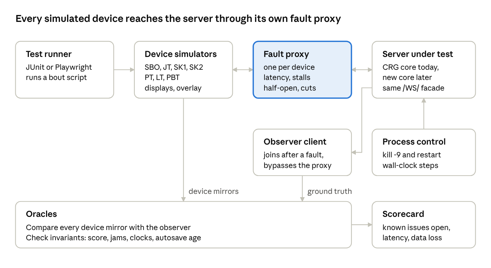
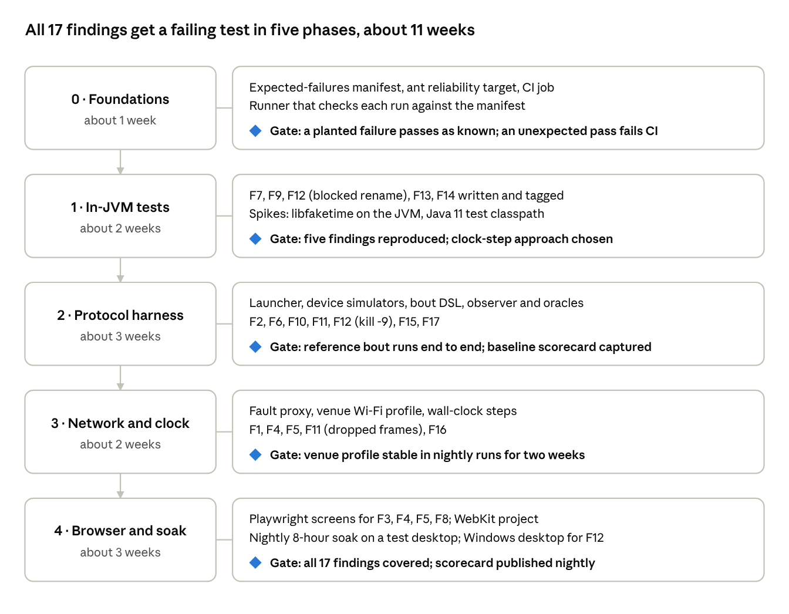

# CRG Scoreboard — Reliability Test Plan

Oct 13, 2026 · @Charles

## Purpose and principles

We will build a reliability suite whose tests fail today, stay in the repo as tracked known issues, and flip to passing as fixes land. The count of flipped tests is the running proof that each change made the scoreboard more reliable for a multi-table crew on venue Wi-Fi.

- **Test the facade, not the internals.** Most tests drive the real server through its public surfaces: the `/WS/` protocol, the HTTP endpoints, and the files it writes. Those surfaces survive the strangler-fig rewrite, so one suite can judge both the old core and the new one.
- **Venue Wi-Fi is the default environment.** Every networked test runs several simulated devices (SBO, JT, two SKs, PT, LT, PBT, two displays, an overlay) through a proxy that injects latency, loss and dropouts. The single-laptop path is a smoke test only.
- **Assert what a crew needs, not how the code does it.** Oracles are invariants an NSO would recognise: the clock is right, every press has a visible outcome, every device converges to the same score, nothing is lost on a crash.
- **A known failure must stay failing until it is truly fixed.** Known-issue tests are strict: an unexpected pass fails the build until someone flips the marker on purpose.
- **Deterministic where it can be, statistical where it must be.** Time and faults are injected under test control. Tests that depend on races run many seeded iterations and report a failure rate, not a single verdict.

Kept separate from the existing tests: the suite lives in its own `reliability/` source tree with its own `ant reliability` target, so `ant test` (and `ant zip`, which depends on it) never compiles or runs it.

The suite maps one-to-one onto the 18 findings from the code review (F1–F18), so every test answers a question already raised. One test, the F7 pilot, comes first and validates the plan and workflow before the others are written.

## Test architecture

The suite has five layers, and all but the first drive a real server process from outside. Layers 1–3 stay in Java and JUnit 4.13 (decided: most of the codebase is Java), so they run under the existing `ant` build and CircleCI job; the browser layer uses Playwright on the Node toolchain the repo already has for ESLint.

Today's 22 JUnit test files (about 7,000 lines) exercise the game model in-process. They call `ScoreBoardClock.getInstance().stop()` and advance time by hand, so they bypass the wall-clock path entirely. That is why F1 has never surfaced in CI, and it is the main gap these layers close.

| Layer | What it drives | Faults it can inject | Findings it reaches |
| --- | --- | --- | --- |
| 1. In-JVM characterization | `ScoreBoardImpl`, `JSONStateManager`, `AutoSaveJSONState` directly | Throwing listeners, register/unregister churn, a temp autosave dir with blocked renames or truncated files | F7, F9, F12, F13, F14 |
| 2. Black-box protocol harness | The packaged server on a random port in a temp dir, through `/WS/`, `/Load`, `/SaveJSON` | Simulated devices sending commands concurrently; slow or non-reading clients | F2, F6, F10, F11, F15 |
| 3. Network and environment faults | Layer 2, with a fault proxy between each device and the server, plus process control | Latency, jitter, stalls, half-open sockets, mid-message disconnects; `kill -9` and restart; wall-clock steps via libfaketime; launching from another working directory | F1, F4, F5, F11, F12, F16 |
| 4. Browser end-to-end | The real HTML screens in Chromium via Playwright | Socket closed or blackholed, offline mode, hotkeys pressed while disconnected | F3, F4, F5, F8 |
| 5. Soak | A scripted two-period bout with the full crew on a venue Wi-Fi profile, time sped up with libfaketime | All of the above at low rates, over hours | Regressions, memory growth, F15, F16 |

### Shared building blocks

- **Server launcher.** Starts the built jar in a fresh temp directory on a free port the harness picks and passes as `--port=N`, with `--import=` to skip auto-import. It exposes `kill()`, `restart()`, the log, and the autosave folder. A second launcher implementation will later start the new core, so every layer 2–5 test can run against either.
- **Device simulator.** A WebSocket client per role (SBO, JT, SK1, SK2, PT, LT, PBT, main display, overlay). It registers the same paths the real screen registers, mirrors state the way `WS.js` does, and records every command it sends with a timestamp. Which devices a scenario uses comes from a crew profile file in reliability/: the default is the nine-device crew above, and profiles for other device counts or screen mixes are added as users report setups that need them.
- **Fault proxy.** A small in-process TCP proxy per device, written for the harness so tests stay deterministic: add latency, pause a direction, blackhole without closing (half-open), or cut mid-frame. A Toxiproxy or `tc netem` profile is used only for the soak layer.
- **Bout scripts.** A small Java DSL of crew actions (`jt.startJam()`, `sk1.trip(4)`, `pt.penalty("12", "X")`) that compiles to the same `Set` and `StartNewGame` messages the screens send. A reference bout derived from a real statsbook import gives realistic data.
- **Observer and oracles.** A fresh observer client connected after each fault is the ground truth for server state. Oracles compare every device's mirror against it and check domain invariants: score equals the sum of jam scores, one current jam, contiguous jam numbers, game time against a monotonic reference.

Commands and state cross the proxy in both directions; the observer skips it, which is why it can serve as the reference.

## Known-issue lifecycle

Every test asserts the correct behaviour and simply fails while the bug exists. Nothing in `src/` or `tests/` changes and no annotation is needed: the expected outcomes live in one manifest inside `reliability/`, and the `ant reliability` target compares each run against it. The run is green while known bugs persist and red only when something changes.

1. **Write.** The test asserts what the crew needs. Run it on `dev`, confirm it fails for the reason in the finding, then add a line to `reliability/expected-failures.json`: the test name, the finding ID, and a short expected-failure message, so an unrelated crash does not count.
2. **Live in CI.** `ant reliability`, separate from `ant test`, runs the suite and checks it against the manifest. Until upstream agrees, it runs in a fork's CI or as a non-blocking CircleCI job: layers 1–2 on every PR, layers 3–4 on PRs touching the server or `html/json` and nightly, the soak nightly.
3. **Flip.** The PR that fixes the issue deletes its manifest line. A test that passes while still listed fails the reliability run with "issue looks fixed", so the manifest cannot go stale.
4. **Guard.** From then on it is an ordinary regression test, and it runs against both the old and the new core during the strangler-fig migration.

Race-dependent tests (F6, F11, F14) carry an iteration count and an observed failure rate in their manifest line: they run N seeded iterations and record the rate. The issue counts as fixed only when the rate is zero across the nightly run, and a rising rate on a PR is reported even while the issue is still open.

The manifest doubles as the readable list of open findings and their tests. If maintainers later prefer the expectation next to each test, the entries convert to an annotation in one mechanical change.

## Test catalog

Seventeen findings get at least one test, and every test below is expected to fail on today's `dev`. F18 (missing tests in these areas) is what the suite itself fixes. Thresholds are first proposals, to tune once the harness measures the current baseline.

| ID | Finding | Scenario | Passes when | Layer |
| --- | --- | --- | --- | --- |
| F1 | Game time follows the wall clock | Mid-jam, step the system clock +5 min, later −5 min (libfaketime) | Jam and period clocks stay within 1 s of a monotonic reference; no jam auto-ends; no freeze | 3 |
| F2 | Stats export holds the core lock | Export the statsbook during a jam with nine devices connected | No clock update gap over 1.2 s; commands sent during export apply within 500 ms | 2 |
| F3 | Displays don't interpolate | Main display behind 300 ms jitter, plus a 2 s server stall | Shown seconds never skip or repeat; display within 250 ms of the observer | 4 |
| F4 | Commands dropped while disconnected | Cut the SBO socket, press the Start Jam hotkey, restore within 3 s | The jam starts, or the screen shows the press failed; never silent | 3, 4 |
| F5 | Half-open sockets go unnoticed | Blackhole the PT tablet without closing for 60 s, then heal | "Not connected" shows within 10 s; after healing, the tablet converges with no reload | 3, 4 |
| F6 | Commands judged against arrival state | SBO and JT both press Stop within 400 ms; a toggle sent from a stale view; two devices press different buttons within 1 s | Exactly one jam end, no lineup started, no auto-undo; the toggle lands as the operator saw it | 2 |
| F7 | Undo can leave controls dead | A listener throws during an undo's restore, then the SBO presses Start Jam | Start, Stop and Timeout work within 1 s; all clocks run | 1 |
| F8 | `alert()` on authorization errors | A read-only device sends a `Set`, then updates keep arriving | No modal; updates keep applying; the error shows inline | 4 |
| F9 | No transactional integrity | A listener throws in the middle of Start Jam and of a score change | The change is fully applied or not at all; invariants hold; autosave never holds the partial state | 1 |
| F10 | Relative updates aren't idempotent | The same "+1 trip point" delivered twice with one request ID | Applied once (needs request IDs in the protocol) | 2 |
| F11 | Lost deltas and the `Register` race | Drop one frame to an SK; connect a display that registers immediately, 500 times | Every device matches the observer within 2 s with no reload; no missing team names | 2, 3 |
| F12 | Autosave isn't durable | `kill -9` at random points through a bout; block the rename of the newest autosave | Restart restores state from at most 10 s before the kill; a failed save is reported within 20 s | 1, 3 |
| F13 | Partial loads are accepted | Newest autosave has one malformed value, or a truncated tail | The loader rejects it, falls back to the next file, and says so | 1 |
| F14 | Fan-out race on connect and disconnect | 50 clients connect and disconnect in a loop while clocks run | No exception reaches the core thread; no tick or command is lost (rate test) | 1 |
| F15 | Unbounded per-client queues | One overlay client stops reading for 5 min during play | Other devices' latency is unchanged; server memory stays bounded; the slow client resyncs | 2 |
| F16 | Paths and log growth | Launch from a different working directory; an 8-hour soak | Blank statsbook and import are found; the log stays under a size cap | 3, 5 |
| F17 | Upload path traversal and old dependencies | Upload a media file named `../../config/autosave/x.json`; run a dependency scan | Upload rejected with nothing written outside the media folder; no high-severity advisories | 2 |

## Reliability scorecard

Each nightly run publishes one JSON scorecard, and the trend of these numbers is how we show a change made the scoreboard better. The first row counts flipped tests; the rest are measured under a fixed venue Wi-Fi profile (nine devices, 80 ms ± 60 ms latency, one 5 s dropout per device per 10 minutes), so a fix can improve a number before it flips a whole test. The profile's latency, jitter, dropout and device-count parameters live in one file under reliability/, and each scorecard records the profile version, so recalibrating from real venue captures later shows up as a marked break in the trend rather than a silent shift.

| Metric | How it is measured | First target |
| --- | --- | --- |
| Known issues open | Tests still listed in the manifest, by finding | 0 of 17 |
| Press-to-visible latency, p95 | Command sent by a device to the change seen by every display | Under 300 ms |
| Silent command loss | Commands with no state change and no error shown, per 1,000 | 0 |
| Convergence after a dropout | Fault healed to device mirror equal to the observer | Under 2 s |
| Clock error per hour | Game time against a monotonic reference, including injected clock steps | Under 1 s |
| Data lost on a hard kill | Seconds of play missing after `kill -9` and restart | Under 10 s |
| Fan-out race rate | Core-thread exceptions per 10,000 connect/disconnect cycles | 0 |
| Server memory after an 8-hour soak | Heap after a full GC, against the start of the run | Under 1.5× |

The baseline for each metric is captured on `dev` in Phase 1, before any fix, and kept as the reference line on every later chart.

## Phased rollout

The suite lands in five phases over about 11 weeks of one developer's time. We start with one pilot test, for F7, and take it through the whole workflow — write it, confirm it fails on `dev` for the right reason, add its manifest entry, run it on all three OSes, simulate a fix to see it flip — then hold a short retrospective. Only once the pilot works do we implement the rest of the tests, starting with four more in-JVM findings in Phase 1. Each phase ends at a gate, and no fix work needs to wait for the last phase: a finding can be fixed as soon as its test exists.

From Phase 2, the harness is driven by **traces**, one JSON Lines format for scripted scenarios and, later, for traces captured at real games ([Phase 2 design](docs/phase2-protocol-harness.md)).

Phase 0 is deliberately small so the known-issue convention is agreed before many tests depend on it. It is started on demand rather than on a schedule, and the suite checks itself with `ant -f reliability/build.xml verify`; scheduled runs start in Phase 1. The week estimates are rough and assume someone who already knows the codebase.

## Risks and open questions

The biggest risk is flaky timing tests, which would teach people to ignore the suite. Each risk below has a planned response.

| Risk | Response |
| --- | --- |
| Timing-based assertions flake | Time is injected wherever possible; thresholds start loose and tighten from measured baselines; race tests report rates. A test that flakes twice in a week moves to nightly until fixed. |
| libfaketime may not intercept the JVM's wall clock on every JDK and glibc combination | Spike it first in Phase 1, with `FAKETIME_DONT_FAKE_MONOTONIC=1` so only the wall clock steps. Fallback: a small Java agent that redirects `System.currentTimeMillis`. |
| The autosave failure (F12) is mostly a Windows file-locking problem | Linux approximates it by blocking the rename target; a Windows desktop among the test machines covers the real case. |
| Real tablets behave differently from Chromium (iPad sleep, Android Wi-Fi handoff) | Add Playwright's WebKit project, and keep a short manual drill for a real-device rehearsal before each release. |
| The harness needs Java 11+ (`java.net.http.WebSocket`) while the product targets Java 8 | Only the test code needs it; the test desktops run a current JDK. |

Tests run on dedicated desktops, so contention for test machines and run-time budgets are not a concern; the full 8-hour soak can run nightly.

### Strangler fig: next steps

The rearchitecture direction and the workstreams to choose milestone 1 from are in [docs/strangler-fig-next-steps.md](docs/strangler-fig-next-steps.md). In short: fix the core first, so version-1 clients benefit; use the recording proxy only to capture real games; add protocol version 2 as optional JSON fields with a version negotiation.

### Open design question: autosave semantics

Status: **partly decided (Oct 21, 2026).** Owner: Charles. Recovery history is decided: per-game checkpoints at every jam boundary, plus a Restore screen; see [docs/recovery-checkpoints.md](docs/recovery-checkpoints.md), section 6, for the answers so far. The loss window, power loss and autosave failure reporting are still open.

We have not yet defined what autosave is supposed to guarantee. Several findings (F12, F13) and targets (data lost on a hard kill) depend on that definition, so for now their tests encode **provisional** expectations. Once this question is settled, those tests and targets are revisited.

**What autosave does today** (on `dev`, from reading the code):
- Every 10 s, the whole state is written as one JSON snapshot to `config/autosave/scoreboard-0-secs-ago.json`: every game, plus settings, teams, rulesets and devices. Seven rotating files cover roughly the last 60 s.
- At start-up, the existing files are copied to `config/autosave/backup/<timestamp>/`, and the newest file that parses is loaded. A value that fails partway through a load leaves entries from the rejected file behind (F13).
- Writes are not flushed to disk, and failed renames are ignored (F12). Failures go only to the log.
- A save also runs on clean shutdown.
- Separately, each game's own JSON is written to `html/game-data/json/` after each jam and when the score is made official. The statsbook export is a third, manual copy.

**Questions to answer:**
1. **Loss window.** How much play may be lost, and in which failures: a process crash, a power cut, the laptop sleeping, a full or locked disk? Today it's up to 10 s, and nothing is guaranteed after a power cut.
2. **History.** How far back must an operator be able to go, and how? For example, "undo the last two minutes" or "restore the state before the period started". Who triggers it, and from which screen?
3. **Consistency.** Must every snapshot be a consistent point between operator actions, and every restore all-or-nothing? If the newest snapshot can't be loaded, should the scoreboard fall back silently, fall back and warn, or stop and ask?
4. **Visibility.** When saving fails or falls behind, who is told, and where: the SBO screen, every operator screen, only the log?
5. **Source of truth.** How do the autosave, the per-game JSON and the statsbook relate? Which one wins after a crash, and which is authoritative after the game?
6. **Scope.** One snapshot of everything, or per game? Should device and operator data be included?
7. **Versions.** Must a newer release load an older release's autosave, and the other way round?
8. **Architecture.** In the strangler-fig rewrite, does autosave stay a periodic snapshot, or become something else, such as an append-only log of operator actions? The answer shapes the persistence seam in the rewrite plan.

**What currently rests on provisional answers:**
- F12's test assumes the latest change must survive a locked autosave file.
- F13's test assumes a rejected snapshot leaves no trace.
- The scorecard target "data lost on a hard kill: under 10 s" (Phase 2) assumes today's 10 s interval is acceptable.

Retention and failure-reporting tests are not written until questions 2 and 4 are answered.

Open questions:

- [x] This will land upstream in `rollerderby/scoreboard`. Decided: until maintainers agree on a convention, expectations stay in a manifest inside reliability/ instead of a `@KnownIssue` annotation.
- [x] Decided: the first crew screens the simulators mirror are SBO, JT, two SKs, PT, LT, PBT, main display and overlay. Other device counts and mixes become extra crew profiles as users report them.
- [x] There is no real venue network capture or crew report yet, so the Wi-Fi profile starts from the guessed 80 ms ± 60 ms. Its parameters live in a profile file under reliability/ and get recalibrated once captures exist.
