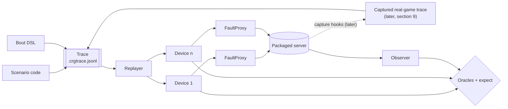

# Phase 2: protocol harness design

Status: draft for review · Parent plan: [README.md](../README.md) · Builds on [Phase 0](phase0-foundations.md), [Phase 1](phase1-in-jvm.md) and the [libfaketime spike](spike-libfaketime.md) · Oct 20, 2026

Phase 2 builds a harness that drives the **real, packaged server** the way a venue crew does. Simulated devices connect over the `/WS/` WebSocket and the HTTP endpoints. The harness then uses that to add tests for F2, F6, F10, F11 (the Register race), F12 (data lost on `kill -9`), F15 and F17.

The central design choice: **every interaction with the server is a trace.** Hand-written scenarios, scripted bouts and, later, traces captured from real games are all the same JSON Lines file. One replayer is the only code that talks to the server. Replaying a real game that went wrong is then not a new feature, just another trace.



Like earlier phases, the harness runs on demand on the test desktops, with no scheduled runs and no CI. It changes only files under `reliability/`. Capturing traces from real games needs changes to the product, so that is a separate design (section 9). This one only fixes the format and the constraints that capture must meet.

## 1. Decisions

| Topic | Decision |
| --- | --- |
| What a test drives | The packaged `lib/crg-scoreboard.jar`, started as its own process in a temp directory. Tests never reach into its internals: everything goes through `/WS/` and the HTTP endpoints, so the same tests can later judge the rewritten core. |
| Harness input | A **trace**: the format in section 3. Scenario code and the bout DSL build traces in memory; captured traces are loaded from files. One `Replayer` executes all of them. |
| Java level | The `reliability/` tree moves to **Java 11** (`--release 11`), for `java.net.http.WebSocket` and `HttpClient`. The product stays on Java 8, and M12 keeps checking the root build. The test desktops already run JDK 21. |
| Network path | Every simulated device connects **through its own `FaultProxy`** from the start. In Phase 2 the proxy only passes traffic through and can cut a connection. Latency, stalls and half-open sockets arrive in Phase 3 without restructuring. |
| First test | A **pilot** (pilot retro, change 4): F6, with two devices reacting to one timeout whistle (section 7). It exercises the launcher, two devices, a trace, the replayer, the observer and an oracle. The rest of Phase 2 starts after its retro. |
| F1 (wall-clock steps) | **In Phase 2** (decided Oct 20, 2026). `ServerLauncher` starts the server under libfaketime on Linux (and on macOS, if the spike's probe works there), driven by `clock` events. On Windows, a real system-clock step runs only when you opt in (`-Dreliability.allowClockChanges=true`, elevated PowerShell); otherwise the test is `SKIPPED`. |
| Registered paths | Generated from the real screens by an automated harvest (section 6), not hand-written. |
| Scheduling | None. On demand only. |

## 2. What the spike established

These were checked against the packaged server on `dev` (scratch run, Oct 20, 2026):

- **Device identity is the session cookie.** `GET /` returns `Set-Cookie: CRG_SCOREBOARD=…`. A WebSocket opened with that cookie is one device. The server's first frame names the device (`WS.Device.Id`, `WS.Device.Name`) and the connection (`WS.Client.Id`).
- **Write access:** on a fresh server with no writable devices, new devices may write (`MayWrite=true`).
- **Screens address games by ID.** The SBO screen writes `ScoreBoard.Game(<uuid>).StartJam`, taking the ID from its URL (`?game=<uuid>`). The `ScoreBoard.CurrentGame` paths are a read-only mirror. **A trace therefore carries real game IDs, so replay must start from a state that contains those games** (section 3.3).
- **The message sequence works end to end:** `Register` a path, then `Set …StartJam true`. The server first echoes the current `InJam=false`, then pushes `InJam=true`.

## 3. Trace format, version 1

A trace is a UTF-8 **JSON Lines** file, `*.crgtrace.jsonl`. Line 1 is a header; every further line is one event.

### 3.1 Header

```json
{"trace": 1, "crgVersion": "<git describe of the server>", "origin": "synthetic",
 "seed": {"autosave": "seeds/two-teams-short-periods.json"},
 "devices": {"sbo": {"source": "/nso/sbo?game=$GAME", "platform": "trace"},
             "jt":  {"source": "/nso/jt?game=$GAME",  "platform": "trace"}},
 "vars": {"GAME": "6f1c…"},
 "redacted": false,
 "notes": "F6 pilot: SBO and JT press Stop 300 ms apart"}
```

| Field | Meaning |
| --- | --- |
| `trace` | Format version, currently 1. |
| `crgVersion` | Server version that produced the trace (captured) or that it was written against (synthetic). Informational only; replay doesn't refuse a mismatch, but it is reported. |
| `origin` | `synthetic` (written by hand or by the DSL) or `captured` (recorded from a real server). |
| `seed` | The state the server starts from. `autosave` names a file in the autosave format, installed as the server's newest autosave before start-up, so the product loads it the normal way. Omit it for a fresh server. |
| `devices` | Trace-local device names, with the page path each one claims to be (`source`, as sent by `WS.js`) and a `platform` string. |
| `vars` | Values substituted for `$NAME` in `source`, `key`, `paths` and `value`. They keep synthetic traces readable, and let one trace run against a different seed. |
| `redacted` | `true` if names and other personal data were replaced (section 9). |
| `notes` | Free text. |

### 3.2 Events

Every event has:
- `t`: milliseconds since the trace started, on a **monotonic** clock;
- `ev`: the event type;
- `dev`: the device name, for device events.

Captured traces may also carry `wall` (the server's wall-clock milliseconds) so clock steps (F1) can be seen and replayed.

| `ev` | Fields | Meaning on replay |
| --- | --- | --- |
| `connect` | `dev` | The device gets a cookie (if it hasn't one yet) and opens `/WS/` through its proxy. A device keeps its cookie across reconnects, as a browser does. |
| `send` | `dev`, `msg` | Send `msg` **verbatim** as one text frame: a JSON object exactly as `WS.js` would send it (`Register`, `Set`, `StartNewGame`, `Ping`). |
| `disconnect` | `dev`, `how` | `close`: a clean close frame. `drop`: kill the TCP connection without a close frame, through the proxy. |
| `http` | `dev`, `method`, `path`, `body` | An HTTP request carrying the device's cookie, e.g. `POST /Load/JSON` with a file from the trace's directory. |
| `recv` | `dev`, `msg` | (Captured traces only, optional.) A frame the server sent. **Not replayed**; kept for diagnosis and diffing. |
| `stall` | `dev`, `ms` | (Synthetic only.) The device stops reading for `ms`, so the server's sends to it back up (F15). |
| `clock` | `step` | (Synthetic only.) Step the server's wall clock, as in the spike (F1). |
| `kill` | `signal`, `restart` | (Synthetic only.) Kill the server process (`-9`, i.e. a hard kill, or `term`), optionally restarting it on the same directory and port. |
| `expect` | `dev?`, `within`, `state` | A checkpoint: within `within` ms, the given state keys must have the given values, as seen by `dev` or by the observer. If not, replay records a failure with the trace line number. |
| `mark` | `label` | A label for reports. |

### 3.3 Why the format looks like this

These are the constraints that make captured real-game traces possible later:

1. **Messages are verbatim wire text.** Capture can record exactly what arrived, with no interpretation. Replay sends the same bytes, so a bug in how the server parses a message is reproduced too.
2. **Starting state is part of the trace.** Real traces start mid-game, and messages name real game IDs. Capture writes the current autosave as the trace's seed at the moment recording starts, and replay installs that seed before start-up.
3. **Devices are named per trace, and cookies are created at replay.** Real cookies are secrets and must never be stored. Capture maps each real device to a stable trace-local name.
4. **Time is monotonic, with wall time optional.** Replay timing uses `t`. `wall` keeps evidence of clock steps without making replay depend on the host clock.
5. **The server's view, not the client's.** Captured `t` is the arrival time at the server, which already includes Wi-Fi delay. A synthetic trace's `t` is the send time. Replay sends at `t`, so a replayed captured trace has a little extra latency; fault-proxy settings can account for it in Phase 3.
6. **Assertions are separate from inputs.** `expect` lines are written by people (or derived from a bug report), never captured, and can be added to a captured trace without editing its other lines.

## 4. Replay

`Replayer.run(trace, options)` launches the server with the seed, connects devices, and executes events in `t` order. It returns a `ReplayResult`: failed `expect`s, per-device message logs, and the observer's final state.

Options:

| Option | Default | Meaning |
| --- | --- | --- |
| `timing` | `realtime` | `realtime`: wait until each event's `t`. `asap`: send each event as soon as the previous event to the same device has been sent, keeping per-device order. `asap` is useful for pure logic traces; game clocks need `realtime`. |
| `speed` | `1.0` | Multiplies realtime gaps. Values other than 1 only make sense together with a faked server clock (Phase 3 on Linux). |
| `stopAtFirstFailure` | `false` | Stop when an `expect` fails. |

The server keeps real time, so the game clocks run while a trace replays. A trace that depends on clock values must be replayed with `realtime` timing, and its `expect`s must allow for tolerance (e.g. "jam clock between 110 s and 115 s").

## 5. Components

All of these live in `reliability/src/com/carolinarollergirls/scoreboard/reliability/harness/`.

| Component | Responsibility |
| --- | --- |
| `ServerLauncher` | Starts `java -jar lib/crg-scoreboard.jar --port=<free port> --import=` in a fresh directory containing a copy of `config/` (minus `autosave/`) and a link or copy of `html/`. If there is a seed, it installs it as `config/autosave/scoreboard-0-secs-ago.json`. It waits for the port to accept connections, then exposes `kill(signal)`, `restart()`, `stop()`, the PID, the log and the directory. **It always kills the whole process tree:** in a `finally`, in a JVM shutdown hook, and on timeout. It never relies on the server exiting cleanly (pilot retro, change 6). |
| `DeviceClient` | One simulated device: an `HttpClient` with its own cookie store, plus a `WebSocket` opened through its `FaultProxy`. It mirrors state the way `WS.js` does (applying deltas, with `null` deleting a key), timestamps every frame in and out, and can stop reading on demand. |
| `FaultProxy` | A per-device TCP proxy in the test JVM. In Phase 2: pass-through, `cut()` and `drop()`. Phase 3 adds latency, jitter, stalls and half-open connections behind the same interface. |
| `Observer` | A device that bypasses the proxy and registers `ScoreBoard` (everything). It provides ground truth. |
| `Oracles` | Reusable checks. **Convergence:** every device's mirror equals the observer's, for the paths it registered, within N ms. **Game invariants:** one current jam; contiguous jam numbers; team score equals the sum of jam scores; at most one running timeout. **Latency:** a `send` to the matching change at every registered device. |
| `Trace`, `TraceReader`, `TraceWriter` | The model and the JSON Lines reader and writer. The reader validates the version, event types, required fields, increasing `t`, known devices and known `$VARS`, and names the line of any problem. |
| `Bout` (DSL) | Builds synthetic traces: `bout.at(0).device("sbo").startJam()`, `.after(300).device("jt").stopJam()`, `.expect(within(2000), "Game($GAME).InJam", false)`. Each call emits the same `send` JSON that the real screen sends. |
| `CrewProfile` | Which devices a crew has, their `source`, and the paths each one registers (section 6). Loaded from `reliability/crews/*.json`. The default nine-device crew is from the plan. |
| `Seeds` | Autosave-format seed files in `reliability/seeds/`. The first is `two-teams-short-periods.json`: two teams with rosters, plus a test ruleset with 2-minute periods and 30-second jams, so a whole bout replays in about 5 minutes. |

Harness tests are ordinary `*ReliabilityTest` classes run by the existing runner. Each class's JVM launches its own server, so the runner's class timeout and work directory still apply.

## 6. Registered paths

What a device registers decides what the server sends it. That matters for load-sensitive results such as F15 and latency. Each real screen registers many narrow paths, built from its `sb*` attributes when the page loads.

**Measured on `dev` (Oct 20, 2026).** Headless Chromium loaded each real screen against the packaged server, and its `Register` frames were recorded. The same path sets, and broad per-role prefixes for comparison, were then replayed through the harness client while a jam ran:

| Subscription | Paths | Initial load | 10 s of a running jam |
| --- | --- | --- | --- |
| SBO, real screen | 298 | 72 KB | 11 KB |
| SBO, broad (`Game($GAME)`, `Settings`, `Clients`) | 3 | 105 KB | 81 KB |
| Main display, real screen | 145 | 21 KB | 11 KB |
| Main display, broad (`CurrentGame`, `Settings`) | 2 | 65 KB | 57 KB |
| Penalty tracking (team 1), real screen | 119 | 38 KB | not measured |

Broad prefixes are fine for correctness oracles: they receive a superset. But they **overstate steady-state traffic by 5–7×**, which would make F15 and the latency baseline pessimistic. The frame count is about the same, because the server sends one batch per clock tick.

The spike scripts and raw results are in [`phase2-harvest-spike/`](phase2-harvest-spike/).

**Decision: harvest the real paths automatically.** `reliability/tools/harvest-crew.js` starts the packaged server and loads each screen in the crew profile with Playwright and Chromium. It records the screen's `Register` paths, replaces the game ID with `$GAME`, and writes `reliability/crews/<profile>.json`. These generated files are committed. Re-run the harvest when screens change; a stale profile only affects load realism, not correctness.

Playwright is needed only to run the harvest, never to run the tests. Phase 4 needs it anyway. Once real-game capture exists (section 9), captured `Register` events can feed the same files.

## 7. Tests in Phase 2

All tests follow the established conventions:
- assertion messages start with the finding ID;
- each manifest entry has a specific `messagePattern`;
- each note starts with `Trigger:`.

Scenarios are written as traces through the DSL, so each one can also be saved as a `.crgtrace.jsonl` file and replayed on its own.

| Order | Finding | Scenario | Passes when | Trigger |
| --- | --- | --- | --- | --- |
| 1 (pilot) | F6 | The SBO calls a timeout and assigns it to Team 1; the JT presses Timeout for the same whistle 1.2 s later. | One timeout, still Team 1's. On `dev` there are two, and the running one has no owner. | natural |
| 2 | F6 | Two devices press *different* buttons within 1 s: the SBO calls a timeout, and the JT presses Stop 600 ms later. | The SBO's timeout is not silently deleted. On `dev`, the "quick correction" rule treats the second press as one operator correcting the first, and replaces it. | natural |
| 3 | F10 | The same `TripScore +1` change is sent twice, as a retry would. | Applied once. This needs request IDs in the protocol, so it is expected to fail until the protocol changes. | injected (a retry) |
| 4 | F11 | 500 times: connect a display and register immediately. | Every display's mirror shows the team names within 2 s, with no reload. | natural |
| 5 | F2 | The statsbook is exported during a jam with nine devices connected. | No gap in jam-clock updates longer than 1.2 s; a command sent during the export applies within 500 ms. Needs a blank WFTDA StatsBook workbook (`-Dreliability.statsbook=<path>`). The test uploads it the way the Games / Teams / Rulesets screen does (`POST /Load/blank_xlsx`), and proceeds only if the server reports `ScoreBoard.BlankStatsbookFound = true`. It is `SKIPPED`, naming the reason, when no path is given or CRG rejects the workbook. | natural |
| 5b | F1 | During a jam, step the server's wall clock +5 min, then −5 min (`clock` events). | Game clocks stay within 1 s of the harness's monotonic reference; no jam is auto-ended by the step; no freeze. Linux: libfaketime. Windows: opt-in real clock step, otherwise `SKIPPED`. | natural (NTP or a person correcting the clock) |
| 6 | F12 | `kill -9` at a random point in the reference bout, then restart. | The restored state is at most 10 s behind the kill. **Provisional** pending the autosave-semantics decision. | injected (a crash) |
| 7 | F15 | The overlay device stops reading for 5 min during the reference bout. | Other devices' p95 press-to-visible latency stays within 1.5× of a run without the stall; the server stays up under `-Xmx256m`; the overlay converges after it resumes. | injected (a stalled client) |
| 8 | F17 | `POST /Media/upload` with a file named `../../config/autosave/x.json`. | Rejected, and nothing is written outside the media folder. (The dependency-advisory half of F17 needs a network-connected scanner and is tracked separately.) | injected (a hostile upload) |

**The reference bout** is a synthetic trace for the default nine-device crew, built with the DSL from the short-periods seed. It runs about 5 minutes and is played by the F12 and F15 tests and the baseline-latency run.


**Correction (Oct 20, 2026).** The code review predicted that two devices pressing Stop close together would misbehave. Probing `dev` showed that case is guarded: a second Stop during lineup is ignored, and the same button pressed twice within 1 s is dropped. F6's real exposure is two devices pressing **the same button more than 1 s apart**, which the server reads as a deliberate second action (scenario 1), or **different buttons less than 1 s apart**, which it reads as one operator correcting themselves (scenario 2). A fix needs each command to carry the state the operator saw, so the server can tell "same whistle" from "new call".

## 8. Verification

`verify` gains harness checks. Like M1–M15, they never edit tracked files.

| Check | What it proves |
| --- | --- |
| H1 | `ServerLauncher` starts the jar, the port answers, and `stop()` leaves **no process behind**, also after a `kill -9` and a restart. |
| H2 | Trace round-trip: DSL, then writer, then reader gives back an equal trace. The reader rejects a bad version, an unknown event, decreasing `t`, an unknown device or an unknown `$VAR`, naming the line. |
| H3 | A canned trace (`reliability/selfcheck/traces/start-stop.crgtrace.jsonl`) replays: Start Jam, then Stop Jam. Every `expect` passes, and convergence holds for two devices and the observer. |
| H4 | A canned trace with a deliberately wrong `expect` fails, and the failure names the trace line. |

The Phase 2 gate:
- `ant -f reliability/build.xml verify` reports `VERIFY: OK` on Linux, macOS and Windows;
- the F6 pilot works, and its retro is accepted;
- the reference bout replays end to end on all three operating systems, and the scorecard records its baseline p95 press-to-visible latency.

## 9. Later, designed separately: capturing traces from real games

You want to record what happens at real games, especially the server-side interactions that caused problems, and replay them in this harness. That requires changes to the product, so it gets its own design and its own upstream discussion. This harness is built so captured traces drop straight in. The capture design must provide:

- **Hook points** at the server's input edges: `WS.onOpen`, `onMessage`, `onClose` and `onError`; `LoadJsonScoreBoard`; `MediaServlet`; the `/SaveJSON` reads. Optionally, periodic `wall` vs monotonic samples, so clock steps are visible.
- **Output** in exactly this trace format, with the seed taken from the autosave at the moment recording starts.
- **Always-on, low cost**: a ring buffer of the last N minutes, written to disk only when someone asks, for example a "save what just happened" button on the SBO, or automatically on a server-side exception. This matters because people rarely know in advance which game will go wrong.
- **Privacy:** cookies and session IDs are never written. Skater names, numbers and team names can be redacted consistently (the same name always maps to the same placeholder), and the header records `"redacted": true`. Sharing a trace in a bug report must be safe by default.
- **Optional `recv` lines**, so a trace shows what each device was told, not just what it sent.

Open questions for that design:
- the trigger UX ("save what just happened");
- how long the buffer is, and how much memory and disk it may use;
- whether redaction is on by default;
- whether upstream wants capture in the product at all, or as a build flag.

## 10. Out of scope, and open questions

**Out of scope:**
- Network faults beyond `cut` and `drop`: latency, jitter, stalls and half-open connections (Phase 3).
- Browser tests (Phase 4).
- Trace capture in the product (section 9).
- Scheduled runs and CI.

**Decided Oct 20, 2026:**
- F1 is in Phase 2.
- You will put a blank WFTDA StatsBook workbook on each test desktop.
- Registered paths are harvested automatically from the real screens (section 6).

**Open:**
- **Which StatsBook edition CRG accepts.** CRG's documentation asks for the January 2019 workbook; WFTDA's site now offers February 2025. The F2 test reports which one CRG accepted.
