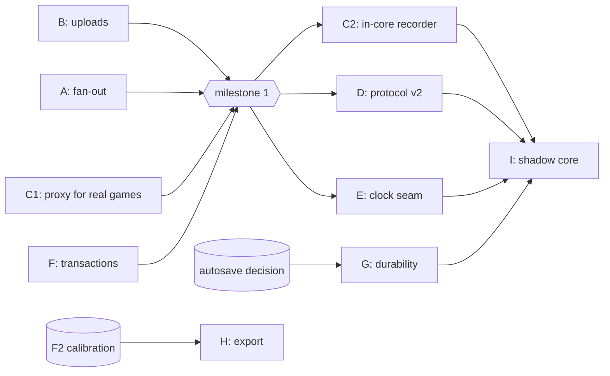

# Strangler fig: proposed next steps

Status: draft, for choosing milestone 1's scope · Parent plan: [README.md](../README.md) · Builds on [Phase 2](phase2-protocol-harness.md) and the recording proxy ([PR #7](https://github.com/cabacon-gmail/scoreboard/pull/7)) · Oct 20, 2026

This is step 3 of the original request: how to rearchitect CRG with the strangler-fig pattern. It records the direction agreed on Oct 20 and lays out workstreams to choose from. **It does not fix milestone 1's scope.** That is the decision this document is for.

## 1. Direction (agreed Oct 20, 2026)

1. **Fix the core first.** Changes go into CRG itself wherever they can, so every crew benefits: version-1 clients, crews that never update their devices, crews that never run anything extra.
2. **The proxy's job is to record traces, not to fix things.** The recording proxy captures real games now, without waiting on upstream, and is a place to try protocol ideas before proposing them. It is not where fixes live. Long term, recording moves into the core as well (workstream C).
3. **The strangler fig happens inside the core.** Each piece is replaced the same way:
   - put a seam around it;
   - build the new implementation behind the seam;
   - check old and new against recorded traces and the reliability suite;
   - switch over.
4. **Protocol version 2 is additive.** New capabilities are optional JSON fields, plus a version negotiation at connect. A version-1 client sends none of them and gets today's behaviour, with the core fixes underneath.

## 2. Proxy or core

| | Recording proxy | Same capability in the core |
| --- | --- | --- |
| Available now, with no upstream change | **Yes** | No: needs review and a release |
| Benefits every user | Only crews who run it | **Yes** |
| Fixes F14, F15 and F11 | Only for devices behind the proxy | **Yes**, with small, contained changes |
| Sees the order CRG applies messages in | No | **Yes** |
| Adds a process that can fail at a game | Yes | No |
| Deployment | A second thing to start | Unchanged |

**Use the proxy for:** recordings from real games, starting now; protocol experiments.
**Don't use it for:** fixes, or anything a crew must run to get correct behaviour.

## 3. Protocol version 2: optional fields in JSON

JSON's missing key works like protobuf's unset optional field. CRG already tolerates extra fields in both directions:
- **Server:** `WS.onMessage` reads only the keys it knows (`action`, `key`, `value`, `flag`, `paths`, `data`), so an old server ignores new fields.
- **Old clients:** `WS.js` reads only `state` and `authorization`, so the server can add new top-level keys.
- **State paths:** new paths are already safe, because a device receives only the paths it subscribed to.

Rules, to make up for what protobuf would enforce:

| Rule | Why |
| --- | --- |
| **A missing field always means version-1 behaviour.** Fields are tested with `containsKey`, never by comparing to null. | jackson-jr returns null both for a missing key and for `null`. CRG already gives `"value": null` a meaning: delete. |
| **Negotiate at connect.** The client sends `{"action":"Hello","protocol":2}`. The server answers with its version and the features it enforces. An old server answers `{"error":"Unknown Action 'Hello'"}`, which the client treats as version 1. | Otherwise a version-2 client could believe it was protected against duplicates by a server that ignores its IDs. |
| **Field names are permanent.** Fields are only ever added, never renamed or retyped. A written schema for each message is checked by harness tests. | JSON has no schema, so a typo is silently ignored. |
| **IDs are strings.** | JavaScript numbers are exact only to 2⁵³, and Jackson's number types vary with the value. |

Planned fields:

| Field | On | Meaning | Fixes |
| --- | --- | --- | --- |
| `id` | `Set`, `StartNewGame` | Unique for the device (device ID plus a counter). The server applies each ID once, even across reconnects, and answers `{"ack": id, "result": "applied" \| "duplicate" \| "rejected", "reason"?}`. | F10, and lets clients retry safely |
| `expect` | `Set` | The state the operator saw, as path-to-value pairs, e.g. `{"…InJam": true, "…CurrentTimeout": ""}`. The server applies the command only if the expectation holds. If the intended result is already in place, it answers `duplicate`; otherwise it answers `rejected` and says why. | F6 |
| `Hello` action | (new) | Negotiation, above. | |

## 4. Workstreams

Each workstream names the findings it addresses and the tests that should flip. The reliability suite runs against each change, and its manifest shows the progress.

| | Workstream | Findings | Tests that flip | Size | Upstream risk | Depends on |
| --- | --- | --- | --- | --- | --- | --- |
| **A** | **Core fan-out.** Make `JSONStateManager`'s set of connected clients thread-safe. Bound each connection's send queue, and give a connection that falls behind a fresh snapshot instead of a growing queue. The same snapshot path fixes reconnects that miss updates. | F14, F15, F11 (lost-update half) | `ReconnectStorm` (rate 0.72 to 0), Phase 1 `FanOut`; F15 and F11 guards stay green | S | Low: bug fixes with no protocol change | — |
| **B** | **Upload path validation.** `validFileName` must reject `..` and separators (it uses `String.matches`, which never matches part of a name), plus a canonical-path check in `createFile`, for plain uploads and zip entries. | F17 | `UploadPath` ×2 | XS | Low: security fix | — |
| **C1** | **Make the proxy ready for real games.** Redact names by default, package it as one file a crew can run, map a reconnecting device back to the same trace device, and write a short "how to record a game" page. | (data collection) | `RecordingProxy` stays green | S | None: separate tool | — |
| **C2** | **In-core recorder.** A `--trace-dir` option records at `WS.onMessage`/`onOpen`/`onClose`, the load and media servlets, and the starting state. Each message gets `(clientId, seq)`, an arrival number taken on entry, and an apply number taken under the core lock. The output is the same trace format, plus an apply-order file, so reordering is visible. Later: a ring buffer and a "save what just happened" button. | Observability for every finding | New capture tests | M | Medium: a new feature, needs agreement | — |
| **D** | **Protocol v2.** `Hello`, `id` with `ack` and server-side duplicate removal, then `expect`. Server side first; then `WS.js` sends v2 fields from the SBO, JT and SK screens. | F10, F6 | `DuplicateDelivery`, `ConcurrentButtons` ×2 (as v2 variants; the v1 tests stay as documentation of v1 behaviour) | M–L | Medium: a protocol change, though additive | — |
| **E** | **Clock seam.** Put game time behind an interface backed by a monotonic source, with a new tick scheduler. The wall clock is used only for display. | F1 | `WallClockStep` | M | Medium: touches every clock | — |
| **F** | **Transactions.** Wrap undo/redo restores and multi-step commands so that a failure rolls back or completes. The minimum is a `try/finally` around `restoreRunning`. | F7, F9 | `Undo`, `Transaction` | S–M | Low | — |
| **G** | **Durability.** Implement whatever the autosave-semantics decision chooses, perhaps a journal of accepted commands replayed on top of the last snapshot. | F12, F13 | `AutosaveLock`, `AutosaveLoad`; F12 guard | M | Medium | **The autosave decision** (main plan) |
| **H** | **Export off the lock.** Copy what the export needs under the lock, then fill the workbook outside it. | F2 | `StatsbookExport` (once calibrated on the desktops) | S | Low | Desktop calibration of F2 |
| **I** | **New core in shadow mode.** Run a new core alongside the old, feed both the same commands (from C2 or live), and compare states. A game switches to the new core only when they match. | Everything that remains | The whole suite against the new core | L | High | C2, a seam around the game model |

## 5. Options for milestone 1

| Option | Contents | What it shows | Rough effort |
| --- | --- | --- | --- |
| **1. Quick wins** | B, A | The fix-and-flip loop works on real code: F17 and F14 flip, F15 and F11 stay green. Every user benefits, with no protocol change. | Days |
| **2. Quick wins plus data** | B, A, C1 | As option 1, plus recordings from real games start arriving, which settles whether F12, F15 and F2 matter in practice before we spend effort on them. | About 1–2 weeks |
| **3. Foundations** | B, A, C1, F, and the design (not the code) of D | As option 2, plus F7 and F9 flip, and the protocol v2 design goes upstream for discussion early, while the code is still cheap to change. | About 3–4 weeks |

**Decided (Oct 20, 2026): option 2.** As built:
- **B** ([PR #8](https://github.com/cabacon-gmail/scoreboard/pull/8)): F17 flipped, for plain uploads and zip entries.
- **A** ([PR #9](https://github.com/cabacon-gmail/scoreboard/pull/9)): the F14 fan-out race, plus two ordering races found while fixing it (a new listener's snapshot overtaking a newer update, and `WS.java` locking on an object it replaces). F14 flipped at the protocol level (72% to 0) and in-JVM (45% to 0).
- **F15's bounded queues are deferred.** The overlay's real subscription never fills the socket buffers, so there is no failing test to prove a change. Real recordings decide whether it comes back.
- **C1** is on the `milestone1` branch: names redacted by default, a reconnecting device kept as one trace device, a one-file `crg-recorder.jar` with launchers that start CRG behind it, and crew instructions (`reliability/RECORDING.md`).

Recommendation was **option 2**. It fixes real bugs for every crew, and it starts collecting the evidence the rest of the plan depends on. Three of the review's predictions (F12, F15 and possibly F2) did not hold at realistic load, so real recordings should decide G and H, not the review.

## 6. How each change is proven

1. Before the change, the finding's test is `KNOWN` or a `rate` entry in the manifest.
2. The change lands on a branch. The finding's tests report `UNEXPECTED_PASS`, or the rate drops to 0, and the manifest entry is deleted in the same PR.
3. The full `verify` passes on Linux, Windows and macOS.
4. Replaying recorded real games on the old and new builds gives the same results, except where a finding was fixed. Workstream C provides those recordings.

## 7. Open questions

1. **Working with upstream.** When and how do we raise A and B (bug fixes) and D (protocol) with the CRG maintainers? Small, separate PRs for A and B seem easiest to accept. D needs a discussion first.
2. **Autosave semantics** (owner: you). This blocks G, and also shapes C2's ring buffer and the persistence seam in I.
3. **Redaction default** for recordings: names hidden unless the crew opts in, or the reverse?
4. **Packaging** for C1: a script next to CRG's own launcher, a single jar, or part of CRG's release zip?
5. **Where the protocol v2 schema lives** (the product repo, beside `WS.js`, seems right) and how it is checked (harness tests).
6. **Java level for core changes.** The product is on Java 8. Do fixes stay Java 8-compatible, or does the product move up too?
